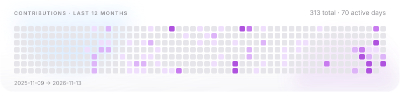
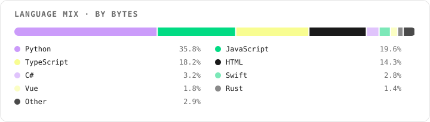

<div align="center">


# flying~dragon

**角色卡 · CHARACTER SHEET**

`open to work` · `flying-dragon-ai` · since 2019

</div>

<table>
<tr>
<td width="34%" valign="top">

**角色卡**

```text
┌────────────────────┐
│ 名  flying~dragon  │
│ 职  agent 工程师   │
│ 阵  Agent 基础设施 │
│ LV  6              │
└────────────────────┘
```

</td>
<td width="66%" valign="top">

**属性**

| | |
| --- | --- |
| **语言** | Python 36% / JavaScript 20% / TypeScript 18% |
| **仓库** | 15 own · 52 forks |
| **贡献** | 311 / 12mo · 70 active days |
| **峰值** | 2026-06-21 · 24 commits |

</td>
</tr>
</table>

## 技能树

- **Windows 内部与安全工具** · 1 件 — 只读审计、端点对抗、零依赖 PowerShell。
- **Agent 基础设施** · 8 件 — pi 扩展、subagent 工厂、skill 打包、AIGC 流水线。
- **3D 与交互式 Web** · 3 件 — Three.js / WebGL / 单文件离线包，浏览器里跑得动的真 3D。
- **小程序与产品 MVP** · 2 件 — 微信小程序 + Koa API，从原型到可交付。
- **社区与元信息** · 1 件 — 交流入口与占位仓库。

## 图鉴

| 作品 | 简介 | 语言 |
| --- | --- | --- |
| **[tihuqiche](https://github.com/flying-dragon-ai/tihuqiche)** | 鹈鹕骑车：可离线游玩的单文件 3D 骑车闯关游戏 | JavaScript |
| **[win-raccoon-lab](https://github.com/flying-dragon-ai/win-raccoon-lab)** | 只读的 Windows 缓存审计工具：152 条实测缓存地图 + 9 道安全闸门，已回收 30.53 GB。PowerShell，零依赖。 | PowerShell |
| **[pi-subagent-factory](https://github.com/flying-dragon-ai/pi-subagent-factory)** | Auto-scan any codebase and generate a tailored pi subagent team with ready-to-use s… | TypeScript |
| **[knowledge-takeback-skill](https://github.com/flying-dragon-ai/knowledge-takeback-skill)** | npm/npx skill that turns AI-assisted tasks into interactive HTML knowledge pages, s… | JavaScript |
| **[super-agentic-diner](https://github.com/flying-dragon-ai/super-agentic-diner)** | 超级智能体餐厅 Crossroads Agent Cafe - lightweight AI ordering demo: FastAPI + keyword RAG… | Python |
| **[seedance-agent](https://github.com/flying-dragon-ai/seedance-agent)** | Agent-driven AIGC video production pipeline on Volcano Ark Seedance API (2.5/2.0):… | Python |

<div align="center"><picture>
  <source media="(prefers-color-scheme: dark)" srcset="assets/stats-lavender-dark.svg">
  <source media="(prefers-color-scheme: light)" srcset="assets/stats-lavender-light.svg">
  
</picture></div>

<div align="center"><picture>
  <source media="(prefers-color-scheme: dark)" srcset="assets/heatmap-lavender-dark.svg">
  <source media="(prefers-color-scheme: light)" srcset="assets/heatmap-lavender-light.svg">
  
</picture></div>

<div align="center"><picture>
  <source media="(prefers-color-scheme: dark)" srcset="assets/lang-bar-lavender-dark.svg">
  <source media="(prefers-color-scheme: light)" srcset="assets/lang-bar-lavender-light.svg">
  
</picture></div>

## 阵营

| 方向 | # | 仓库 |
| --- | --- | --- |
| **Windows 内部与安全工具** | 1 | [win-raccoon-lab](https://github.com/flying-dragon-ai/win-raccoon-lab) |
| **Agent 基础设施** | 8 | [super-agentic-diner](https://github.com/flying-dragon-ai/super-agentic-diner) · [knowledge-takeback-skill](https://github.com/flying-dragon-ai/knowledge-takeback-skill) · [seedance-agent](https://github.com/flying-dragon-ai/seedance-agent) · [pi-smart-search](https://github.com/flying-dragon-ai/pi-smart-search) · [smartsearch](https://github.com/flying-dragon-ai/smartsearch) · [pi-subagent-factory](https://github.com/flying-dragon-ai/pi-subagent-factory) · +2 |
| **3D 与交互式 Web** | 3 | [tihuqiche](https://github.com/flying-dragon-ai/tihuqiche) · [pet-world](https://github.com/flying-dragon-ai/pet-world) · [mom_remember](https://github.com/flying-dragon-ai/mom_remember) |
| **小程序与产品 MVP** | 2 | [Pocket_Travel_Companion](https://github.com/flying-dragon-ai/Pocket_Travel_Companion) · [Shibi_Gallery](https://github.com/flying-dragon-ai/Shibi_Gallery) |
| **社区与元信息** | 1 | [openhongguo-community](https://github.com/flying-dragon-ai/openhongguo-community) |

<div align="center">

数据由 gh CLI 拉取后静态渲染，不接受手工维护。

**[flying-dragon-ai](https://github.com/flying-dragon-ai)** · 15 repos · 6 stars · 311 contributions / 12mo

<sub>README 由 `gh` 拉取真实数据后渲染 · 最后更新 2026-11-13</sub>

</div>
