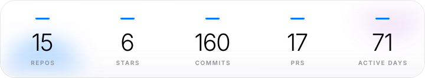
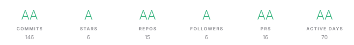
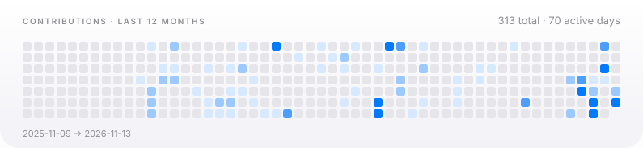
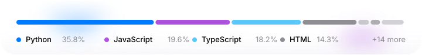

<div align="center">


# flying~dragon

**PLAYER CARD**

`open to work` · `flying-dragon-ai` · since 2019

</div>

```text
┌───────────────────────────────────────┐
│ flying~dragon  LV.6  flying-dragon-ai │
│ XP  ████░░░░░░░░░░░░░░░░  11/50       │
│ HP  70 active days   MP  146 commits  │
└───────────────────────────────────────┘

ACHIEVEMENTS
  [☆] Windows 内部与安全工具 1 repos
  [★] Agent 基础设施         8 repos
  [☆] 3D 与交互式 Web        3 repos
  [☆] 小程序与产品 MVP       2 repos
  [☆] 社区与元信息           1 repos

ACTIVE QUESTS
  ▸ tihuqiche                  鹈鹕骑车：可离线游玩的单文件 3D 骑车闯关游戏
  ▸ win-raccoon-lab            只读的 Windows 缓存审计工具：152 条实测缓存地图 + 9 道安全闸门，已回收…
  ▸ pi-subagent-factory        Auto-scan any codebase and generate a tailore…
  ▸ knowledge-takeback-skill   npm/npx skill that turns AI-assisted tasks in…
```

## 我是谁

agent 基础设施：把模型能力包成能装、能跑、能交付的东西 —— pi 扩展、subagent 工厂、skill 打包、AIGC 流水线。

3D Web：Three.js / WebGL / 单文件离线包，浏览器里跑得动的真 3D。

Windows 内部工具：只读审计、端点对抗、零依赖 PowerShell。

> 当前主线：pi 生态的扩展与 subagent 编排。

<div align="center"><picture>
  <source media="(prefers-color-scheme: dark)" srcset="assets/stats-openbuild-dark.svg">
  <source media="(prefers-color-scheme: light)" srcset="assets/stats-openbuild-light.svg">
  
</picture></div>

<div align="center"><picture>
  <source media="(prefers-color-scheme: dark)" srcset="assets/trophy-openbuild-dark.svg">
  <source media="(prefers-color-scheme: light)" srcset="assets/trophy-openbuild-light.svg">
  
</picture></div>

<div align="center"><picture>
  <source media="(prefers-color-scheme: dark)" srcset="assets/heatmap-openbuild-dark.svg">
  <source media="(prefers-color-scheme: light)" srcset="assets/heatmap-openbuild-light.svg">
  
</picture></div>

<div align="center"><picture>
  <source media="(prefers-color-scheme: dark)" srcset="assets/lang-bar-openbuild-dark.svg">
  <source media="(prefers-color-scheme: light)" srcset="assets/lang-bar-openbuild-light.svg">
  
</picture></div>

## 地图

| 方向 | # | 仓库 |
| --- | --- | --- |
| **Windows 内部与安全工具** | 1 | [win-raccoon-lab](https://github.com/flying-dragon-ai/win-raccoon-lab) |
| **Agent 基础设施** | 8 | [super-agentic-diner](https://github.com/flying-dragon-ai/super-agentic-diner) · [knowledge-takeback-skill](https://github.com/flying-dragon-ai/knowledge-takeback-skill) · [seedance-agent](https://github.com/flying-dragon-ai/seedance-agent) · [pi-smart-search](https://github.com/flying-dragon-ai/pi-smart-search) · [smartsearch](https://github.com/flying-dragon-ai/smartsearch) · [pi-subagent-factory](https://github.com/flying-dragon-ai/pi-subagent-factory) · +2 |
| **3D 与交互式 Web** | 3 | [tihuqiche](https://github.com/flying-dragon-ai/tihuqiche) · [pet-world](https://github.com/flying-dragon-ai/pet-world) · [mom_remember](https://github.com/flying-dragon-ai/mom_remember) |
| **小程序与产品 MVP** | 2 | [Pocket_Travel_Companion](https://github.com/flying-dragon-ai/Pocket_Travel_Companion) · [Shibi_Gallery](https://github.com/flying-dragon-ai/Shibi_Gallery) |
| **社区与元信息** | 1 | [openhongguo-community](https://github.com/flying-dragon-ai/openhongguo-community) |

<div align="center">

**[▶ 进入 3D 城市](https://thegitcity.com)** — 贡献数决定楼高，star 数决定窗户亮度。

</div>

<div align="center">

数据由 gh CLI 拉取后静态渲染，不接受手工维护。

**[flying-dragon-ai](https://github.com/flying-dragon-ai)** · 15 repos · 6 stars · 311 contributions / 12mo

<sub>README 由 `gh` 拉取真实数据后渲染 · 最后更新 2026-11-13</sub>

</div>
