# flying~dragon

**入れて使えるもの、開いて遊べるものを作ります。pi 拡張、MCP サーバー、Windows 内部ツール、そして実際に動く 3D プロダクト。**

公開済みの npm パッケージ 2 つ、独自ドメインで動く 3D ゲーム 1 本、そして 30.53 GB を回収しながら 1 バイトも失わなかった読み取り専用の Windows 監査ツール。

<a href="https://github.com/flying-dragon-ai">GitHub</a> · <a href="https://pi.dev/packages">pi パッケージ</a> · <a href="https://tihuqiche.com/">tihuqiche を遊ぶ</a> · [English](README.md) · [简体中文](README.zh-CN.md) · **[日本語](README.ja.md)** · [한국어](README.ko.md) · [Русский](README.ru.md)

---

## 01 · 主なプロジェクト

<table>
<tr><td width="50%" valign="top">
<strong><a href="https://github.com/flying-dragon-ai/tihuqiche">Pelican Pedal Run</a></strong>

島と都市をめぐる 12 ステージ、4 モード、オフライン単一ファイル版。Vue 3 + Three.js、いまブラウザで遊べます。

<a href="https://tihuqiche.com/">遊ぶ ↗</a>
</td><td width="50%" valign="top">
<strong><a href="https://github.com/flying-dragon-ai/pet-world">ペット・デジタルキーパー</a></strong>

モバイル向けペット管理アプリ：AI 問答、健康記録、ライブ配信。デプロイ済みで実際に開けます。スライドの中のスクリーンショットではありません。

<a href="https://flying-dragon-ai.github.io/pet-world/">開く ↗</a>
</td></tr>
<tr><td width="50%" valign="top">
<strong><a href="https://github.com/flying-dragon-ai/win-raccoon-lab">win-raccoon</a></strong>

読み取り専用の Windows キャッシュ監査：実測 152 件、9 つの安全ゲート、30.53 GB を回収してデータ損失ゼロ。エンジンに破壊的なコマンドレットはなく、ゲート 7 が自分のソースを grep してそれを証明します。

<a href="https://github.com/flying-dragon-ai/win-raccoon-lab">ソース ↗</a>
</td><td width="50%" valign="top">
<strong><a href="https://github.com/flying-dragon-ai/figma-mcp-plus">figma-mcp-plus</a></strong>

Figma からコードへ、8 段階のルールエンジン——DSL、ツリー、レイアウト、視覚処理、エクスポート——で 98%+ SSIM。VLM はフォールバックであって手法ではありません。

<a href="https://github.com/flying-dragon-ai/figma-mcp-plus">ソース ↗</a>
</td></tr>
</table>

## 02 · ツールチェーン

| ツール | できること | インストール |
| --- | --- | --- |
| **[pi-subagent-factory](https://github.com/flying-dragon-ai/pi-subagent-factory)** | 最大 6,000 ファイルを走査し、ツール許可リスト付きの subagent を 4〜10 個生成。走査のモデルトークンはゼロ。 | `pi install npm:pi-subagent-factory` |
| **[pi-provider-xhx](https://github.com/flying-dragon-ai/pi-provider-xhx)** | 小浣熊を pi の一級プロバイダに：OAuth ループバック、ライブのモデルカタログ、pi 自身のクライアントでストリーミング。 | `pi install npm:pi-provider-xhx` |
| **[seedance-agent](https://github.com/flying-dragon-ai/seedance-agent)** | 絵コンテのプリフライト、認証情報の順序付きローテーション、レジューム可能なダウンロード、ffmpeg ポスト。買い直すのではなく再実行できる AIGC 動画。 | — |
| **[msep-blind](https://github.com/flying-dragon-ai/msep-blind)** | Infogo MSEP のエンドポイントエージェントを停止させ、再起動をまたぎ、必要なら完全に戻す。PowerShell、依存なし。 | — |

## 03 · 上流への貢献

マージ済みのプルリクエストのみ。うち 2 件は自分のリポジトリ、残りは上流プロジェクトに送って取り込まれたパッチです。

| リポジトリ | マージ済み PR | 最新の変更 |
| --- | --- | --- |
| [llingqi77-tech/interview-new](https://github.com/llingqi77-tech/interview-new) | [9](https://github.com/llingqi77-tech/interview-new/pull/9) · [4](https://github.com/llingqi77-tech/interview-new/pull/4) · [3](https://github.com/llingqi77-tech/interview-new/pull/3) · [2](https://github.com/llingqi77-tech/interview-new/pull/2) · [1](https://github.com/llingqi77-tech/interview-new/pull/1) | refactor: 拆开会话引擎、LLM 路由和报告打分 |
| [flying-dragon-ai/interview-new](https://github.com/flying-dragon-ai/interview-new) | [2](https://github.com/flying-dragon-ai/interview-new/pull/2) · [1](https://github.com/flying-dragon-ai/interview-new/pull/1) | 多角色 StepFun Realtime 全双工（无领导讨论 + 可配置单面） |
| [Frankieli123/grok-skill](https://github.com/Frankieli123/grok-skill) | [2](https://github.com/Frankieli123/grok-skill/pull/2) | feat(api): 优化 JSON 解析与支持 SSE 流解析 |
| [TEN-framework/ten-framework](https://github.com/TEN-framework/ten-framework) | [2028](https://github.com/TEN-framework/ten-framework/pull/2028) | #2014 docs(voice-assistant): 重构README，详细说明PowerMem记忆功能 |
| [labring/FastGPT](https://github.com/labring/FastGPT) | [6338](https://github.com/labring/FastGPT/pull/6338) | #6193 feat(SeekDB): 集成支持 SeekDB 向量数据库 |

## 04 · 現在取り組んでいること

| | |
| --- | --- |
| **課題** | figma-mcp-plus は深い重なりを持つレイアウトで、まだ VLM にフォールバックします。 |
| **判断** | DSL は重なり・はみ出し・包含関係を記録していますが、z-order の意図を記録していないため、レイアウト段階で重なり順を決定論的に解けません。 |
| **次の検証** | ツリーとレイアウトの間に重なり解決ステージを挿入し、固定の 20 画面の重なりコーパスで前後の SSIM を測ります。 |

## 05 · 目標と根拠

| 目標 | 主要結果 | 根拠 | それが意味すること |
| --- | --- | --- | --- |
| **O1** 導入できるエージェントツールを届ける | KR1 · npm パッケージ 2 つを公開 | pi-subagent-factory 0.1.0 · pi-provider-xhx 0.3.0 —— どちらも `pi install npm:…` | 導入コストはコマンド 1 行で、ソースを読む時間ではない |
| **O2** システムツールを検証可能にする | KR2 · 30.53 GB を回収し、データ損失ゼロ | win-raccoon-lab：実測 152 件のキャッシュ、9 つの安全ゲート、probe F1 = 1.00 | 掃除は「ワンクリック最適化」ではなく、まず証拠を出す作業になる |
| **O3** リズムを保つ | KR3 · 394 コミット / 73 アクティブ日 | 18 個の自前リポジトリが 5 言語にわたり、1 日最大 69 コミット | 成果は一発の爆発ではなくリズム |

<strong>技術スタックとライブ信号</strong>

| # | 技術 | 使用場面 |
| --- | --- | --- |
| 1 | **Python** | MCP サーバー、AIGC パイプライン、FastAPI バックエンド |
| 2 | **TypeScript** | pi 拡張、Vue 3 / React 19 フロントエンド、ミニプログラム |
| 3 | **JavaScript** | 単一ファイルの 3D ゲーム、npm スキル、ビルドスクリプト |
| 4 | **PowerShell** | Windows の読み取り専用監査、エンドポイント向けツール |
| 5 | **Three.js / R3F** | 3D Web —— tihuqiche、エージェント喫茶のフロントエンド |
| 6 | **HTML / CSS** | オフラインで動く単一ファイル成果物 |

## 06 · 連絡先

入口は GitHub だけです。該当リポジトリの issue がメールより速いです。

[GitHub](https://github.com/flying-dragon-ai) · [pi パッケージ](https://pi.dev/packages) · [tihuqiche を遊ぶ](https://tihuqiche.com/)

README と上のすべての SVG は `gh` で取得した実データから生成されています · since 2019
