<div align="center">



<br>

<sub>[English](README.md) · [简体中文](README.zh-CN.md) · **[日本語](README.ja.md)** · [한국어](README.ko.md) · [Русский](README.ru.md)</sub>

</div>

---

**「動く」で終わらせず、届く形にします。pi 拡張、MCP サーバー、Windows 内部ツール。直近 12 か月で 379 コミット・73 アクティブ日、そのうち 3 つはコマンド 1 行で導入できます。**

```yaml
role:     エンジニア · エージェント基盤と Windows 内部ツール
focus:    pi 拡張 · MCP サーバー · 読み取り専用システムツール
proof:    figma-mcp-plus — 8 段階ルールエンジン、98%+ SSIM のデザイン→コード
cadence:  379 コミット / 73 アクティブ日 / 1 日最大 69
contact:  github.com/flying-dragon-ai
```

## 01 · 目標と主要結果

| 目標 | 主要結果 | 進捗と根拠 | それが意味すること |
| --- | --- | --- | --- |
| **O1** エージェント能力を届く形にする | KR1 · 3 つのパッケージをコマンド 1 行で導入 | pi-provider-xhx、pi-subagent-factory、knowledge-takeback-skill —— `pi install npm:…` / `npx …` | 導入コストはコマンド 1 行で、ソースを読む時間ではない |
| **O1** エージェント能力を届く形にする | KR2 · デザイン→コードの再現度 ≥ 98% SSIM | figma-mcp-plus：8 段階パイプライン、ルールエンジン優先、VLM はフォールバックのみ | デザイン受け渡しが手作業の再描画でなくなる |
| **O2** システムツールを検証可能にする | KR3 · 30.53 GB を回収し、データ損失ゼロ | win-raccoon-lab：実測 152 件のキャッシュマップ、9 つの安全ゲート、probe F1 = 1.00 | 掃除は「ワンクリック最適化」ではなく、まず証拠を出す作業になる |
| **O3** リズムを保つ | KR4 · 381 コミット / 73 アクティブ日 | 18 個の自前リポジトリが 5 言語にわたり、1 日最大 69 コミット | 成果は一発の爆発ではなくリズム |

<div align="center"></div>

## 02 · 主なプロジェクト

### [figma-mcp-plus](https://github.com/flying-dragon-ai/figma-mcp-plus)

- **課題** — Figma からコードへの変換は、たいてい視覚モデルがピクセルを推測する作業です。実行ごとに再現度がぶれ、試すたびにトークンを消費します。
- **やったこと** — ルールベースのレイアウトエンジンを書きました。8 段階パイプライン（DSL → ツリー → レイアウト → 視覚処理 → エクスポート）で、VLM はフォールバックに降格。出力は index.html・スライス画像・フォントを含む ZIP で、そのまま React / Vue / Swift / Kotlin に変換できます。
- **結果と影響** — 再現度 98%+ SSIM。同じデザインからは同じコードが二度出てきます。
### [win-raccoon-lab](https://github.com/flying-dragon-ai/win-raccoon-lab)

- **課題** — 掃除ツールは「ワンクリック最適化」を押させて、何を消したのかを教えてくれません。
- **やったこと** — 読み取り専用の監査ツールを作りました。152 件のキャッシュパスを実機で計測し、3 段階の安全レベルに分類。1 バイト動かす前に 9 つのゲートを通します。
- **結果と影響** — 実測 30.53 GB を回収し、データ損失ゼロ。実測セットで probe F1 = 1.00。
### [pi-subagent-factory](https://github.com/flying-dragon-ai/pi-subagent-factory)

- **課題** — プロジェクトごとに subagent チームを手書きする必要があり、その名簿は実際のスタックから静かにずれていきます。
- **やったこと** — 最大 6,000 ファイルを走査するルールエンジン——言語、フレームワーク、DB、テストランナー、ビルド、monorepo、Docker、CI——を書き、4〜10 個のエージェントを決定論的に生成します。各エージェントにはツール許可リストと思考レベルが付きます。
- **結果と影響** — 走査のモデルトークン消費はゼロ。React + Prisma + Vitest のリポジトリで 5 秒以内に 8 エージェント。
### [seedance-agent](https://github.com/flying-dragon-ai/seedance-agent) · ★2

- **課題** — AIGC 長尺動画の生成は再現できません。認証情報が 1 つ死ぬか、ポーリングが 1 回落ちるだけで予算が丸ごと消えます。
- **やったこと** — 絵コンテのプリフライト、認証情報の順序付きローテーション、非同期ポーリング、レジューム可能なダウンロード、ffmpeg によるポストプロダクション。さらにエージェント自身にパイプラインを操作させるスキルファイルを用意しました。
- **結果と影響** — 絵コンテはゼロからではなく、最後に成功したセグメントから再開します。

## 03 · 現在取り組んでいること

| | |
| --- | --- |
| **課題** | figma-mcp-plus は深い重なりを持つレイアウトで、まだ VLM にフォールバックします。 |
| **判断** | DSL は重なり・はみ出し・包含関係を記録していますが、z-order の意図を記録していないため、レイアウト段階で重なり順を決定論的に解けません。 |
| **次の検証** | ツリーとレイアウトの間に重なり解決ステージを挿入し、固定の 20 画面の重なりコーパスで前後の SSIM を測ります。 |

## 04 · 技術スタック

| # | 技術 | 使用場面 |
| --- | --- | --- |
| 1 | **Python** | MCP サーバー、AIGC パイプライン、FastAPI バックエンド |
| 2 | **TypeScript** | pi 拡張、Vue 3 / React 19 フロントエンド、ミニプログラム |
| 3 | **JavaScript** | 単一ファイルの 3D ゲーム、npm スキル、ビルドスクリプト |
| 4 | **PowerShell** | Windows の読み取り専用監査、エンドポイント向けツール |
| 5 | **Three.js / R3F** | 3D Web —— tihuqiche、エージェント喫茶のフロントエンド |
| 6 | **HTML / CSS** | オフラインで動く単一ファイル成果物 |

## 05 · 連絡先

入口は GitHub だけです。該当リポジトリの issue がメールより速いです。

[GitHub](https://github.com/flying-dragon-ai) · [pi パッケージ](https://pi.dev/packages) · [tihuqiche を遊ぶ](https://tihuqiche.com/)

<div align="center"></div>

<sub>README と上のすべての SVG は `gh` で取得した実データから生成されています · since 2019</sub>
