<div align="center">



<br>

<sub>[English](README.md) · [简体中文](README.zh-CN.md) · [日本語](README.ja.md) · **[한국어](README.ko.md)** · [Русский](README.ru.md)</sub>

</div>

---

**돌아가는 것에서 끝내지 않고 배포되는 형태로 만듭니다. pi 확장, MCP 서버, Windows 내부 도구. 최근 12개월 동안 379회 기여·73일 활동, 그중 셋은 명령 한 줄로 설치됩니다.**

```yaml
role:     엔지니어 · 에이전트 인프라와 Windows 내부 도구
focus:    pi 확장 · MCP 서버 · 읽기 전용 시스템 도구
proof:    figma-mcp-plus — 8단계 규칙 엔진, 98%+ SSIM 디자인→코드
cadence:  379회 기여 / 73일 활동 / 하루 최대 69회
contact:  github.com/flying-dragon-ai
```

## 01 · 목표와 핵심 결과

| 목표 | 핵심 결과 | 진행과 근거 | 이것이 의미하는 것 |
| --- | --- | --- | --- |
| **O1** 에이전트 역량을 배포 가능한 형태로 | KR1 · 세 패키지를 명령 한 줄로 설치 | pi-provider-xhx, pi-subagent-factory, knowledge-takeback-skill — `pi install npm:…` / `npx …` | 도입 비용은 명령 한 줄이지, 소스를 읽는 시간이 아니다 |
| **O1** 에이전트 역량을 배포 가능한 형태로 | KR2 · 디자인→코드 재현도 ≥ 98% SSIM | figma-mcp-plus: 8단계 파이프라인, 규칙 엔진 우선, VLM은 폴백만 | 디자인 인계가 손으로 다시 그리는 일이 아니게 된다 |
| **O2** 시스템 도구를 검증 가능하게 | KR3 · 30.53 GB 회수, 데이터 손실 0 | win-raccoon-lab: 실측 152개 캐시 맵, 9개 안전 게이트, probe F1 = 1.00 | 정리는 '원클릭 최적화'가 아니라 먼저 증거를 내는 일이 된다 |
| **O3** 리듬 유지 | KR4 · 380회 기여 / 73일 활동 | 18개 자체 저장소가 5개 언어에 걸쳐 있고, 하루 최대 69회 | 산출은 한 번의 폭발이 아니라 리듬 |

<div align="center"></div>

## 02 · 주요 프로젝트

### [figma-mcp-plus](https://github.com/flying-dragon-ai/figma-mcp-plus)

- **문제** — Figma에서 코드로 가는 길은 대개 비전 모델이 픽셀을 추측하는 일이다. 실행마다 재현도가 흔들리고, 시도할 때마다 토큰이 나간다.
- **한 일** — 규칙 기반 레이아웃 엔진을 만들었다. 8단계 파이프라인(DSL → 트리 → 레이아웃 → 시각 처리 → 내보내기)이고 VLM은 폴백으로 내렸다. 산출물은 index.html·슬라이스·폰트를 담은 ZIP이라 어떤 LLM이든 React, Vue, Swift, Kotlin으로 이어서 변환할 수 있다.
- **결과와 영향** — 재현도 98%+ SSIM. 같은 디자인에서 같은 코드가 두 번 나온다.
### [win-raccoon-lab](https://github.com/flying-dragon-ai/win-raccoon-lab)

- **문제** — 정리 도구는 '원클릭 최적화'를 누르게 하고, 무엇을 지웠는지는 끝까지 알려주지 않는다.
- **한 일** — 읽기 전용 감사를 만들었다. 152개 캐시 경로를 실기에서 측정해 세 단계 안전 등급으로 나누고, 한 바이트도 움직이기 전에 9개 게이트를 통과시킨다.
- **결과와 영향** — 실측 30.53 GB 회수, 데이터 손실 0. 실측 집합에서 probe F1 = 1.00.
### [pi-subagent-factory](https://github.com/flying-dragon-ai/pi-subagent-factory)

- **문제** — 프로젝트마다 subagent 팀을 손으로 써야 하고, 그 명단은 실제 스택에서 조용히 어긋난다.
- **한 일** — 최대 6,000개 파일을 스캔하는 규칙 엔진을 만들었다. 언어, 프레임워크, DB, 테스트 러너, 빌드 도구, monorepo, Docker, CI를 읽고 4~10개 에이전트를 결정적으로 생성한다. 각 에이전트에는 도구 허용 목록과 사고 수준이 붙는다.
- **결과와 영향** — 스캔에 쓰는 모델 토큰 0. React + Prisma + Vitest 저장소에서 5초 안에 8개 에이전트.
### [seedance-agent](https://github.com/flying-dragon-ai/seedance-agent) · ★2

- **문제** — AIGC 장편 영상 생성은 재현이 안 된다. 자격 증명 하나가 죽거나 폴링이 한 번 끊기면 예산이 통째로 탄다.
- **한 일** — 스토리보드 사전 점검, 자격 증명 순차 로테이션, 비동기 폴링, 이어받기 다운로드, ffmpeg 후반 작업을 넣었다. 에이전트가 파이프라인을 직접 몰도록 가르치는 스킬 파일도 함께 두었다.
- **결과와 영향** — 스토리보드는 0에서가 아니라 마지막으로 성공한 구간에서 이어서 돈다.

## 03 · 지금 푸는 문제

| | |
| --- | --- |
| **문제** | figma-mcp-plus는 깊게 겹친 레이아웃에서 여전히 VLM으로 폴백한다. |
| **판단** | DSL은 겹침·넘침·포함 관계는 기록하지만 z-order 의도는 기록하지 않는다. 그래서 레이아웃 단계에서 쌓임 순서를 결정적으로 풀 수 없다. |
| **다음 검증** | 트리와 레이아웃 사이에 겹침 해석 단계를 넣고, 고정된 20화면 겹침 코퍼스로 전후 SSIM을 측정한다. |

## 04 · 기술 스택

| # | 기술 | 사용 장면 |
| --- | --- | --- |
| 1 | **Python** | MCP 서버, AIGC 파이프라인, FastAPI 백엔드 |
| 2 | **TypeScript** | pi 확장, Vue 3 / React 19 프런트엔드, 미니프로그램 |
| 3 | **JavaScript** | 단일 파일 3D 게임, npm 스킬, 빌드 스크립트 |
| 4 | **PowerShell** | Windows 읽기 전용 감사, 엔드포인트 도구 |
| 5 | **Three.js / R3F** | 3D 웹 — tihuqiche, 에이전트 카페 프런트엔드 |
| 6 | **HTML / CSS** | 오프라인 단일 파일 산출물 |

## 05 · 연락

입구는 GitHub 하나입니다. 해당 저장소에 이슈를 여는 편이 메일보다 빠릅니다.

[GitHub](https://github.com/flying-dragon-ai) · [pi 패키지](https://pi.dev/packages) · [tihuqiche 플레이](https://tihuqiche.com/)

<div align="center"></div>

<sub>README와 위의 모든 SVG는 `gh`로 가져온 실제 데이터에서 생성됩니다 · since 2019</sub>
