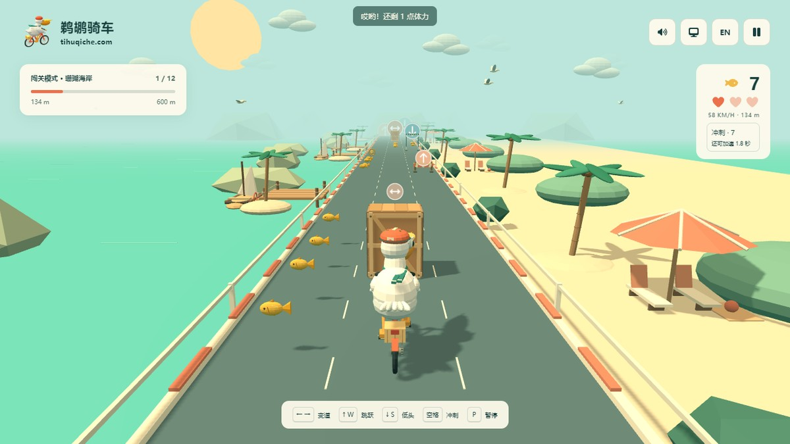
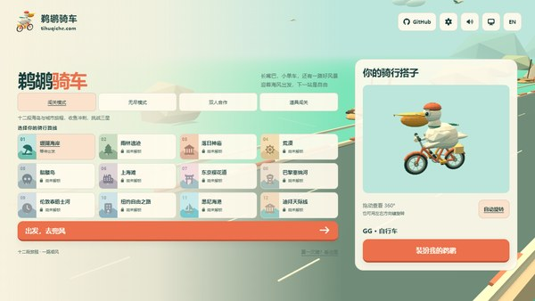
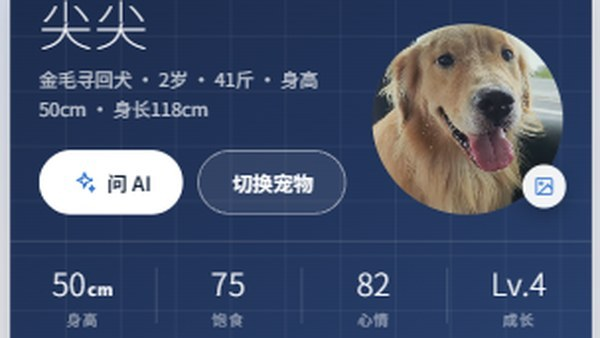
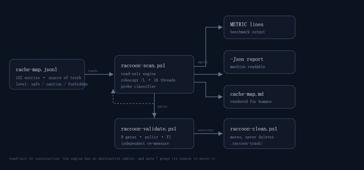

# flying~dragon

**설치해서 쓸 수 있고, 열어서 놀 수 있는 것을 만듭니다. pi 확장, MCP 서버, Windows 내부 도구, 그리고 실제로 돌아가는 3D 제품.**

공개된 npm 패키지 두 개, 자체 도메인에서 돌아가는 3D 게임 하나, 그리고 30.53 GB를 회수하면서 단 1바이트도 잃지 않은 읽기 전용 Windows 감사 도구.

<a href="https://github.com/flying-dragon-ai">GitHub</a> · <a href="https://pi.dev/packages">pi 패키지</a> · <a href="https://tihuqiche.com/">tihuqiche 플레이</a> · [English](README.md) · [简体中文](README.zh-CN.md) · [日本語](README.ja.md) · **[한국어](README.ko.md)** · [Русский](README.ru.md)

---

## 01 · 주요 프로젝트

<table>
<tr><td width="50%" valign="top">
<strong><a href="https://github.com/flying-dragon-ai/tihuqiche">Pelican Pedal Run</a></strong>

섬과 도시를 지나는 12개 스테이지, 4가지 모드, 오프라인 단일 파일 빌드. Vue 3 + Three.js, 지금 브라우저에서 플레이할 수 있습니다.

<a href="https://tihuqiche.com/">플레이 ↗</a>
</td><td width="50%" valign="top">
<strong><a href="https://github.com/flying-dragon-ai/pet-world">펫 디지털 키퍼</a></strong>

모바일 반려동물 관리 앱: AI 문답, 건강 기록, 라이브 방송. 배포되어 실제로 열립니다. 슬라이드 속 스크린샷이 아닙니다.

<a href="https://flying-dragon-ai.github.io/pet-world/">열기 ↗</a>
</td></tr>
<tr><td width="50%" valign="top">
<strong><a href="https://github.com/flying-dragon-ai/win-raccoon-lab">win-raccoon</a></strong>

읽기 전용 Windows 캐시 감사: 실측 152개 항목, 9개 안전 게이트, 30.53 GB 회수에 데이터 손실 0. 엔진에는 파괴적 cmdlet이 없고, 게이트 7이 자기 소스를 grep해 그것을 증명합니다.

<a href="https://github.com/flying-dragon-ai/win-raccoon-lab">소스 ↗</a>
</td><td width="50%" valign="top">
<strong><a href="https://github.com/flying-dragon-ai/figma-mcp-plus">figma-mcp-plus</a></strong>

Figma에서 코드로, 8단계 규칙 엔진——DSL, 트리, 레이아웃, 시각 처리, 내보내기——으로 98%+ SSIM. VLM은 폴백이지 방법이 아닙니다.

<a href="https://github.com/flying-dragon-ai/figma-mcp-plus">소스 ↗</a>
</td></tr>
</table>

## 02 · 도구 체인

| 도구 | 하는 일 | 설치 |
| --- | --- | --- |
| **[pi-subagent-factory](https://github.com/flying-dragon-ai/pi-subagent-factory)** | 최대 6,000개 파일을 스캔해 도구 허용 목록이 붙은 subagent 4~10개를 생성합니다. 스캔에 드는 모델 토큰은 0. | `pi install npm:pi-subagent-factory` |
| **[pi-provider-xhx](https://github.com/flying-dragon-ai/pi-provider-xhx)** | 小浣熊을 pi의 일급 프로바이더로: OAuth 루프백, 실시간 모델 카탈로그, pi 자체 클라이언트로 스트리밍. | `pi install npm:pi-provider-xhx` |
| **[seedance-agent](https://github.com/flying-dragon-ai/seedance-agent)** | 스토리보드 사전 점검, 자격 증명 순차 로테이션, 이어받기 다운로드, ffmpeg 후반 작업. 다시 사는 대신 다시 돌릴 수 있는 AIGC 영상. | — |
| **[msep-blind](https://github.com/flying-dragon-ai/msep-blind)** | Infogo MSEP 엔드포인트 에이전트를 멈추고, 재부팅을 넘기고, 필요하면 완전히 되돌립니다. PowerShell, 의존성 없음. | — |

## 03 · 업스트림 기여

머지된 풀 리퀘스트만 실었습니다. 그중 두 개는 제 저장소이고, 나머지는 업스트림 프로젝트에 보내 받아들여진 패치입니다.

| 저장소 | 머지된 PR | 최근 변경 |
| --- | --- | --- |
| [llingqi77-tech/interview-new](https://github.com/llingqi77-tech/interview-new) | [9](https://github.com/llingqi77-tech/interview-new/pull/9) · [4](https://github.com/llingqi77-tech/interview-new/pull/4) · [3](https://github.com/llingqi77-tech/interview-new/pull/3) · [2](https://github.com/llingqi77-tech/interview-new/pull/2) · [1](https://github.com/llingqi77-tech/interview-new/pull/1) | refactor: 拆开会话引擎、LLM 路由和报告打分 |
| [flying-dragon-ai/interview-new](https://github.com/flying-dragon-ai/interview-new) | [2](https://github.com/flying-dragon-ai/interview-new/pull/2) · [1](https://github.com/flying-dragon-ai/interview-new/pull/1) | 多角色 StepFun Realtime 全双工（无领导讨论 + 可配置单面） |
| [Frankieli123/grok-skill](https://github.com/Frankieli123/grok-skill) | [2](https://github.com/Frankieli123/grok-skill/pull/2) | feat(api): 优化 JSON 解析与支持 SSE 流解析 |
| [TEN-framework/ten-framework](https://github.com/TEN-framework/ten-framework) | [2028](https://github.com/TEN-framework/ten-framework/pull/2028) | #2014 docs(voice-assistant): 重构README，详细说明PowerMem记忆功能 |
| [labring/FastGPT](https://github.com/labring/FastGPT) | [6338](https://github.com/labring/FastGPT/pull/6338) | #6193 feat(SeekDB): 集成支持 SeekDB 向量数据库 |

## 04 · 지금 푸는 문제

| | |
| --- | --- |
| **문제** | figma-mcp-plus는 깊게 겹친 레이아웃에서 여전히 VLM으로 폴백합니다. |
| **판단** | DSL은 겹침·넘침·포함 관계는 기록하지만 z-order 의도는 기록하지 않는다. 그래서 레이아웃 단계에서 쌓임 순서를 결정적으로 풀 수 없다. |
| **다음 검증** | 트리와 레이아웃 사이에 겹침 해석 단계를 넣고, 고정된 20화면 겹침 코퍼스로 전후 SSIM을 측정한다. |

## 05 · 목표와 근거

| 목표 | 핵심 결과 | 근거 | 이것이 의미하는 것 |
| --- | --- | --- | --- |
| **O1** 설치할 수 있는 에이전트 도구를 내놓는다 | KR1 · npm 패키지 두 개 공개 | pi-subagent-factory 0.1.0 · pi-provider-xhx 0.3.0 — 둘 다 `pi install npm:…` | 도입 비용은 명령 한 줄이지, 소스를 읽는 시간이 아니다 |
| **O2** 시스템 도구를 검증 가능하게 | KR2 · 30.53 GB 회수, 데이터 손실 0 | win-raccoon-lab: 실측 152개 캐시, 9개 안전 게이트, probe F1 = 1.00 | 정리는 '원클릭 최적화'가 아니라 먼저 증거를 내는 일이 된다 |
| **O3** 리듬 유지 | KR3 · 401회 기여 / 73일 활동 | 19개 자체 저장소가 5개 언어에 걸쳐 있고, 하루 최대 69회 | 산출은 한 번의 폭발이 아니라 리듬 |

<strong>기술 스택과 실시간 신호</strong>

| # | 기술 | 사용 장면 |
| --- | --- | --- |
| 1 | **Python** | MCP 서버, AIGC 파이프라인, FastAPI 백엔드 |
| 2 | **TypeScript** | pi 확장, Vue 3 / React 19 프런트엔드, 미니프로그램 |
| 3 | **JavaScript** | 단일 파일 3D 게임, npm 스킬, 빌드 스크립트 |
| 4 | **PowerShell** | Windows 읽기 전용 감사, 엔드포인트 도구 |
| 5 | **Three.js / R3F** | 3D 웹 — tihuqiche, 에이전트 카페 프런트엔드 |
| 6 | **HTML / CSS** | 오프라인 단일 파일 산출물 |

## 06 · 연락

입구는 GitHub 하나입니다. 해당 저장소에 이슈를 여는 편이 메일보다 빠릅니다.

[GitHub](https://github.com/flying-dragon-ai) · [pi 패키지](https://pi.dev/packages) · [tihuqiche 플레이](https://tihuqiche.com/)

README와 위의 모든 SVG는 `gh`로 가져온 실제 데이터에서 생성됩니다 · since 2019
