<div align="center">


<br>

<sub>**[English](README.md)** · [简体中文](README.zh-CN.md) · [日本語](README.ja.md) · [한국어](README.ko.md) · [Русский](README.ru.md)</sub>

</div>

---

**I build agent infrastructure that actually ships — pi extensions, MCP servers and Windows internals tools. 384 contributions across 73 active days in the last 12 months, and three of those projects install with a single command.**

```yaml
role:     engineer · agent infrastructure & Windows internals
focus:    pi extensions · MCP servers · read-only system tooling
proof:    figma-mcp-plus — 8-stage rule engine, 98%+ SSIM design-to-code
cadence:  384 contributions / 73 active days / peak 69 in one day
contact:  github.com/flying-dragon-ai
```

## 01 · Objective & Key Results

| Objective | Key Result | Progress / Evidence | What it means |
| --- | --- | --- | --- |
| **O1** Make agent capability deliverable | KR1 · three packages installable in one command | pi-provider-xhx, pi-subagent-factory, knowledge-takeback-skill — `pi install npm:…` / `npx …` | Adoption costs one command, not a source read |
| **O1** Make agent capability deliverable | KR2 · design-to-code fidelity ≥ 98% SSIM | figma-mcp-plus: 8-stage pipeline, rule engine first, VLM only as fallback | Design handoff stops being a manual redraw |
| **O2** Make system tooling auditable | KR3 · zero data loss across 30.53 GB reclaimed | win-raccoon-lab: 152 measured cache entries, 9 safety gates, probe F1 = 1.00 | Cleanup becomes evidence-first instead of a one-click gamble |
| **O3** Keep the cadence | KR4 · 384 contributions / 73 active days | 5 languages across 18 own repositories, peak 69 in a single day | Output is a rhythm, not a burst |

<div align="center"></div>

## 02 · Selected Work

### [figma-mcp-plus](https://github.com/flying-dragon-ai/figma-mcp-plus)

- **Problem** — Figma-to-code is usually a vision model guessing at pixels: fidelity drifts between runs and every attempt costs tokens.
- **What I did** — Built a rule-based layout engine — an 8-stage pipeline (DSL → tree → layout → visual → export) with the VLM demoted to fallback, emitting a ZIP of index.html, slices and fonts that any LLM can convert to React, Vue, Swift or Kotlin.
- **Result** — 98%+ SSIM fidelity, and the same design produces the same code twice.

### [win-raccoon-lab](https://github.com/flying-dragon-ai/win-raccoon-lab)

- **Problem** — Cleanup tools ask you to trust a one-click optimize button and never tell you what it deleted.
- **What I did** — Wrote a read-only audit: 152 cache paths measured against the live host, classified into three safety tiers, 9 gates before a single byte moves.
- **Result** — 30.53 GB reclaimed with zero data loss; probe F1 = 1.00 on the measured set.

### [pi-subagent-factory](https://github.com/flying-dragon-ai/pi-subagent-factory)

- **Problem** — Every project needs a hand-written subagent team, and the roster silently drifts away from the real stack.
- **What I did** — A rules engine that scans up to 6,000 files — languages, frameworks, databases, test runner, build tooling, monorepo, Docker, CI — and deterministically emits 4–10 agents with per-agent tool allowlists and thinking levels.
- **Result** — Zero model tokens spent on the scan; a React + Prisma + Vitest repo gets 8 agents in under 5 seconds.

### [seedance-agent](https://github.com/flying-dragon-ai/seedance-agent) · ★2

- **Problem** — AIGC long-video runs are unreproducible: one dead credential or one dropped poll burns the whole budget.
- **What I did** — Storyboard preflight, ordered credential failover, async polling, resumable downloads, ffmpeg post-production — plus a skill file that teaches the agent to drive the pipeline itself.
- **Result** — A storyboard resumes from the last good segment instead of restarting from zero.

## 03 · Now

| | |
| --- | --- |
| **Problem** | figma-mcp-plus still falls back to the VLM on deeply overlapping layouts. |
| **My judgment** | The DSL records overlap, overflow and containment but not z-order intent, so the layout stage cannot resolve stacking deterministically. |
| **Next verification** | Insert an overlap-resolution stage between tree and layout, then measure SSIM on a fixed 20-screen overlap corpus before and after. |

## 04 · Stack

| # | Technology | Where it is used |
| --- | --- | --- |
| 1 | **Python** | MCP servers, AIGC pipelines, FastAPI backends |
| 2 | **TypeScript** | pi extensions, Vue 3 / React 19 frontends, mini-programs |
| 3 | **JavaScript** | single-file 3D games, npm skills, build scripts |
| 4 | **PowerShell** | read-only Windows audits, endpoint tooling |
| 5 | **Three.js / R3F** | 3D web — tihuqiche, the agent cafe frontend |
| 6 | **HTML / CSS** | offline single-file deliverables |

## 05 · Contact

GitHub is the only door. An issue on the relevant repo is faster than email.

[GitHub](https://github.com/flying-dragon-ai) · [pi packages](https://pi.dev/packages) · [Play tihuqiche](https://tihuqiche.com/)

<div align="center"></div>

<sub>README and every SVG above are generated from live GitHub data via `gh` · since 2019</sub>
