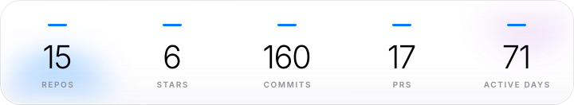
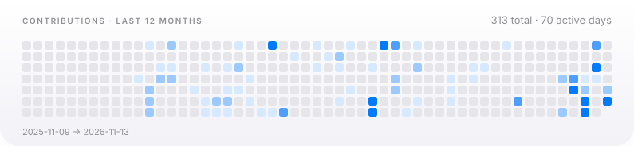

# flying~dragon

**15 个公开仓库，三条产品线，近 12 个月 326 次贡献。**

agent infrastructure · 3D web · windows internals

> 主攻 agent 基础设施（8 个仓库），兼做 3D Web（3 个）与 Windows 内部工具（1 个）。主力栈 Python 35.8%，近 12 个月 70 个活跃日、峰值单日 35 次提交。

<picture>
  <source media="(prefers-color-scheme: dark)" srcset="assets/stats-openbuild-dark.svg">
  <source media="(prefers-color-scheme: light)" srcset="assets/stats-openbuild-light.svg">
  
</picture>

## 01　概览

15 个自有仓库　·　52 个 fork　·　6 个 star　·　18 种语言　·　since 2019

## 02　目标与关键结果

**O1**　建立 agent 基础设施能力　·　8 个仓库　·　达成

**O2**　交付可运行的 3D Web 产品　·　3 个仓库　·　达成

**O3**　沉淀 Windows 内部工具　·　1 个仓库　·　达成

**O4**　保持稳定交付节奏　·　326 贡献 · 70 活跃日　·　进行中

## 03　重点项目

| 项目 | 做了什么 | 结果 |
| --- | --- | --- |
| **[tihuqiche](https://github.com/flying-dragon-ai/tihuqiche)** | 鹈鹕骑车：可离线游玩的单文件 3D 骑车闯关游戏 | 12 关 · 8 种载具 · 4 种模式 · 单文件离线包 |
| **[win-raccoon-lab](https://github.com/flying-dragon-ai/win-raccoon-lab)** | 只读的 Windows 缓存审计工具：152 条实测缓存地图 + 9 道安全闸门，已回收 30.53 GB。PowerShell，零依赖。 | 152 条缓存地图 · 9 道安全闸门 · 回收 30.53 GB |
| **[pi-subagent-factory](https://github.com/flying-dragon-ai/pi-subagent-factory)** | Auto-scan any codebase and generate a tailored pi subagent team with… | 自动扫描代码库并生成 subagent 团队 |
| **[knowledge-takeback-skill](https://github.com/flying-dragon-ai/knowledge-takeback-skill)** | npm/npx skill that turns AI-assisted tasks into interactive HTML know… | npm/npx 分发 · 2 ★ |
| **[super-agentic-diner](https://github.com/flying-dragon-ai/super-agentic-diner)** | 超级智能体餐厅 Crossroads Agent Cafe - lightweight AI ordering demo: FastAPI… | FastAPI + 关键词 RAG，无向量库 · 2 ★ |
| **[seedance-agent](https://github.com/flying-dragon-ai/seedance-agent)** | Agent-driven AIGC video production pipeline on Volcano Ark Seedance A… | 分镜 → 预检 → 生成流水线 · 2 ★ |

## 04　能力分布

<picture>
  <source media="(prefers-color-scheme: dark)" srcset="assets/lang-bar-openbuild-dark.svg">
  <source media="(prefers-color-scheme: light)" srcset="assets/lang-bar-openbuild-light.svg">
  
</picture>

**Windows 内部与安全工具**　1　·　[win-raccoon-lab](https://github.com/flying-dragon-ai/win-raccoon-lab)

**Agent 基础设施**　8　·　[super-agentic-diner](https://github.com/flying-dragon-ai/super-agentic-diner)　[knowledge-takeback-skill](https://github.com/flying-dragon-ai/knowledge-takeback-skill)　[seedance-agent](https://github.com/flying-dragon-ai/seedance-agent)　[pi-smart-search](https://github.com/flying-dragon-ai/pi-smart-search)　+4

**3D 与交互式 Web**　3　·　[tihuqiche](https://github.com/flying-dragon-ai/tihuqiche)　[pet-world](https://github.com/flying-dragon-ai/pet-world)　[mom_remember](https://github.com/flying-dragon-ai/mom_remember)

**小程序与产品 MVP**　2　·　[Pocket_Travel_Companion](https://github.com/flying-dragon-ai/Pocket_Travel_Companion)　[Shibi_Gallery](https://github.com/flying-dragon-ai/Shibi_Gallery)

**社区与元信息**　1　·　[openhongguo-community](https://github.com/flying-dragon-ai/openhongguo-community)

## 05　交付节奏

<picture>
  <source media="(prefers-color-scheme: dark)" srcset="assets/heatmap-openbuild-dark.svg">
  <source media="(prefers-color-scheme: light)" srcset="assets/heatmap-openbuild-light.svg">
  
</picture>

## 06　下一步

1. 提升分发：15 个仓库合计 6 个 star，曝光与文档是当前瓶颈。
2. 整理私有仓库后公开，补齐公开面。
3. 维持节奏：当前 70/370 活跃日，目标是不低于此。

数据由 gh CLI 拉取后静态渲染，不接受手工维护。

**[flying-dragon-ai](https://github.com/flying-dragon-ai)** · 15 repos · 6 stars · 326 contributions / 12mo

README 由 `gh` 拉取真实数据后渲染 · 最后更新 2026-11-13

