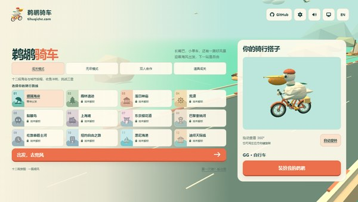

# flying~dragon

**I ship agent infrastructure and playable 3D products — pi extensions, MCP servers, Windows internals tools.**

Two npm packages, one live 3D game on its own domain, and a read-only Windows audit that reclaimed 30.53 GB without losing a byte.

<a href="https://github.com/flying-dragon-ai">GitHub</a> · <a href="https://pi.dev/packages">pi packages</a> · <a href="https://tihuqiche.com/">Play tihuqiche</a> · **[English](README.md)** · [简体中文](README.zh-CN.md) · [日本語](README.ja.md) · [한국어](README.ko.md) · [Русский](README.ru.md)

---

## 01 · Selected

<table>
<tr><td width="50%" valign="top">
<strong><a href="https://github.com/flying-dragon-ai/tihuqiche">Pelican Pedal Run</a></strong>

12 levels across islands and cities, 4 modes, one offline single-file build. Vue 3 + Three.js, playable in the browser right now.

<a href="https://tihuqiche.com/">Play ↗</a>
</td><td width="50%" valign="top">
<strong><a href="https://github.com/flying-dragon-ai/pet-world">Pet Digital Keeper</a></strong>

Mobile pet-management app: AI Q&A, health tracking, live streams. Deployed and clickable, not a screenshot in a slide.

<a href="https://flying-dragon-ai.github.io/pet-world/">Open ↗</a>
</td></tr>
<tr><td width="50%" valign="top">
<strong><a href="https://github.com/flying-dragon-ai/win-raccoon-lab">win-raccoon</a></strong>

Read-only Windows cache audit: 152 measured entries, 9 safety gates, 30.53 GB reclaimed with zero data loss. The engine has no destructive cmdlet, and gate 7 greps its own source to prove it.

<a href="https://github.com/flying-dragon-ai/win-raccoon-lab">Source ↗</a>
</td><td width="50%" valign="top">
<strong><a href="https://github.com/flying-dragon-ai/figma-mcp-plus">figma-mcp-plus</a></strong>

Figma to code through an 8-stage rule engine — DSL, tree, layout, visual, export — at 98%+ SSIM. The VLM is the fallback, not the method.

<a href="https://github.com/flying-dragon-ai/figma-mcp-plus">Source ↗</a>
</td></tr>
</table>

## 02 · Toolchain

| Tool | What it does | Install |
| --- | --- | --- |
| **[pi-subagent-factory](https://github.com/flying-dragon-ai/pi-subagent-factory)** | Scans up to 6,000 files and emits 4–10 subagents with per-agent tool allowlists. Zero model tokens spent on the scan. | `pi install npm:pi-subagent-factory` |
| **[pi-provider-xhx](https://github.com/flying-dragon-ai/pi-provider-xhx)** | 小浣熊 as a first-class pi provider: OAuth loopback, live model catalog, streaming through pi's own client. | `pi install npm:pi-provider-xhx` |
| **[seedance-agent](https://github.com/flying-dragon-ai/seedance-agent)** | Storyboard preflight, ordered credential failover, resumable downloads, ffmpeg post-production. AIGC video that can be re-run instead of re-bought. | — |
| **[msep-blind](https://github.com/flying-dragon-ai/msep-blind)** | Blind the Infogo MSEP endpoint agent on a workstation, survive reboot, restore on demand. PowerShell, no dependencies. | — |

## 03 · Upstream

Merged pull requests only. Two of these are my own repositories; the rest are upstream projects I sent patches to.

| Repository | Merged PRs | Latest change |
| --- | --- | --- |
| [flying-dragon-ai/interview-new](https://github.com/flying-dragon-ai/interview-new) | [2](https://github.com/flying-dragon-ai/interview-new/pull/2) · [1](https://github.com/flying-dragon-ai/interview-new/pull/1) | 多角色 StepFun Realtime 全双工（无领导讨论 + 可配置单面） |
| [Frankieli123/grok-skill](https://github.com/Frankieli123/grok-skill) | [2](https://github.com/Frankieli123/grok-skill/pull/2) | feat(api): 优化 JSON 解析与支持 SSE 流解析 |
| [TEN-framework/ten-framework](https://github.com/TEN-framework/ten-framework) | [2028](https://github.com/TEN-framework/ten-framework/pull/2028) | #2014 docs(voice-assistant): 重构README，详细说明PowerMem记忆功能 |
| [labring/FastGPT](https://github.com/labring/FastGPT) | [6338](https://github.com/labring/FastGPT/pull/6338) | #6193 feat(SeekDB): 集成支持 SeekDB 向量数据库 |

## 04 · Now

| | |
| --- | --- |
| **Problem** | figma-mcp-plus still falls back to the VLM on deeply overlapping layouts. |
| **My judgment** | The DSL records overlap, overflow and containment but not z-order intent, so the layout stage cannot resolve stacking deterministically. |
| **Next verification** | Insert an overlap-resolution stage between tree and layout, then measure SSIM on a fixed 20-screen overlap corpus before and after. |

## 05 · Objective & Evidence

| Objective | Key Result | Evidence | What it means |
| --- | --- | --- | --- |
| **O1** Ship agent tooling people can install | KR1 · two npm packages published | pi-subagent-factory 0.1.0 · pi-provider-xhx 0.3.0 — both `pi install npm:…` | Adoption costs one command, not a source read |
| **O2** Make system tooling auditable | KR2 · zero data loss across 30.53 GB reclaimed | win-raccoon-lab: 152 measured cache entries, 9 safety gates, probe F1 = 1.00 | Cleanup becomes evidence-first instead of a one-click gamble |
| **O3** Keep the cadence | KR3 · 457 contributions / 78 active days | 21 own repositories across 5 languages, peak 69 in a single day | Output is a rhythm, not a burst |

<strong>Stack and live signal</strong>

| # | Technology | Where it is used |
| --- | --- | --- |
| 1 | **Python** | MCP servers, AIGC pipelines, FastAPI backends |
| 2 | **TypeScript** | pi extensions, Vue 3 / React 19 frontends, mini-programs |
| 3 | **JavaScript** | single-file 3D games, npm skills, build scripts |
| 4 | **PowerShell** | read-only Windows audits, endpoint tooling |
| 5 | **Three.js / R3F** | 3D web — tihuqiche, the agent cafe frontend |
| 6 | **HTML / CSS** | offline single-file deliverables |

## 06 · Contact

GitHub is the only door. An issue on the relevant repo is faster than email.

[GitHub](https://github.com/flying-dragon-ai) · [pi packages](https://pi.dev/packages) · [Play tihuqiche](https://tihuqiche.com/)

README and every SVG above are generated from live GitHub data via `gh` · since 2019
