<div align="center">


<br>

<sub>[English](README.md) · [简体中文](README.zh-CN.md) · [日本語](README.ja.md) · [한국어](README.ko.md) · **[Русский](README.ru.md)**</sub>

</div>

---

**Строю инфраструктуру для агентов так, чтобы её можно было поставить одной командой: расширения pi, MCP-серверы, инструменты для внутренностей Windows. За последние 12 месяцев: вкладов — 382, активных дней — 73. Три проекта ставятся одной командой.**

```yaml
role:     инженер · инфраструктура агентов и внутренности Windows
focus:    расширения pi · MCP-серверы · инструменты только для чтения
proof:    figma-mcp-plus — 8-ступенчатый движок правил, 98%+ SSIM из макета в код
cadence:  вкладов 382 / активных дней 73 / пик 69 за день
contact:  github.com/flying-dragon-ai
```

## 01 · Цель и ключевые результаты

| Цель | Ключевой результат | Прогресс и доказательство | Что это значит |
| --- | --- | --- | --- |
| **O1** Сделать возможности агента поставляемыми | KR1 · три пакета ставятся одной командой | pi-provider-xhx, pi-subagent-factory, knowledge-takeback-skill — `pi install npm:…` / `npx …` | Внедрение стоит одну команду, а не чтение исходников |
| **O1** Сделать возможности агента поставляемыми | KR2 · точность макет→код ≥ 98% SSIM | figma-mcp-plus: 8-ступенчатый конвейер, сначала движок правил, VLM только как резерв | Передача макета перестаёт быть ручной перерисовкой |
| **O2** Сделать системные инструменты проверяемыми | KR3 · 30.53 ГБ освобождено, потерь данных ноль | win-raccoon-lab: 152 измеренные записи кэша, 9 предохранителей, probe F1 = 1.00 | Очистка становится работой с доказательствами, а не ставкой на одну кнопку |
| **O3** Держать ритм | KR4 · 382 вкладов / 73 активных дней | 18 собственных репозиториев на 5 языках, пик 69 за один день | Результат — это ритм, а не вспышка |

<div align="center"></div>

## 02 · Избранные проекты

### [figma-mcp-plus](https://github.com/flying-dragon-ai/figma-mcp-plus)

- **Проблема** — Перевод из Figma в код обычно означает, что визуальная модель угадывает пиксели: точность гуляет от запуска к запуску, и каждая попытка стоит токенов.
- **Что сделал** — Написал движок раскладки на правилах — конвейер из 8 ступеней (DSL → дерево → раскладка → визуальная обработка → экспорт), где VLM понижен до резерва. На выходе ZIP с index.html, нарезкой и шрифтами, который любая LLM доводит до React, Vue, Swift или Kotlin.
- **Результат** — Точность 98%+ SSIM: один и тот же макет дважды даёт один и тот же код.

### [win-raccoon-lab](https://github.com/flying-dragon-ai/win-raccoon-lab)

- **Проблема** — Программы очистки просят нажать «оптимизировать одним щелчком» и никогда не говорят, что именно удалили.
- **Что сделал** — Сделал аудит только для чтения: 152 пути кэша измерены на живой машине, разложены по трём уровням безопасности, 9 предохранителей до того, как сдвинется хоть один байт.
- **Результат** — Освобождено 30.53 ГБ без потери данных; probe F1 = 1.00 на измеренном наборе.

### [pi-subagent-factory](https://github.com/flying-dragon-ai/pi-subagent-factory)

- **Проблема** — Каждому проекту нужна написанная руками команда subagent'ов, и этот список тихо расходится с реальным стеком.
- **Что сделал** — Движок правил, который просматривает до 6 000 файлов — языки, фреймворки, базы, тест-раннер, сборка, monorepo, Docker, CI — и детерминированно выдаёт 4–10 агентов с разрешёнными инструментами и уровнем мышления.
- **Результат** — Ноль токенов модели на сканирование; репозиторий React + Prisma + Vitest получает 8 агентов меньше чем за 5 секунд.

### [seedance-agent](https://github.com/flying-dragon-ai/seedance-agent) · ★2

- **Проблема** — Генерация длинного AIGC-видео невоспроизводима: один мёртвый ключ или один потерянный опрос сжигает весь бюджет.
- **Что сделал** — Предполётная проверка раскадровки, упорядоченная ротация ключей, асинхронный опрос, докачиваемые загрузки, постобработка в ffmpeg — плюс файл навыка, который учит агента вести конвейер самому.
- **Результат** — Раскадровка продолжается с последнего удачного фрагмента, а не с нуля.

## 03 · Над чем работаю

| | |
| --- | --- |
| **Проблема** | figma-mcp-plus всё ещё откатывается к VLM на глубоко перекрывающихся раскладках. |
| **Моя оценка** | DSL фиксирует перекрытие, выход за границы и вложенность, но не фиксирует намерение z-order, поэтому ступень раскладки не может детерминированно разрешить порядок наложения. |
| **Следующая проверка** | Вставить ступень разрешения перекрытий между деревом и раскладкой и измерить SSIM на фиксированном корпусе из 20 экранов с перекрытиями до и после. |

## 04 · Стек

| # | Технология | Где применяется |
| --- | --- | --- |
| 1 | **Python** | MCP-серверы, AIGC-конвейеры, бэкенды на FastAPI |
| 2 | **TypeScript** | расширения pi, фронтенды Vue 3 / React 19, мини-программы |
| 3 | **JavaScript** | однофайловые 3D-игры, npm-навыки, сборочные скрипты |
| 4 | **PowerShell** | аудит Windows только для чтения, инструменты для конечных точек |
| 5 | **Three.js / R3F** | 3D в вебе — tihuqiche, фронтенд агентского кафе |
| 6 | **HTML / CSS** | офлайн-поставки одним файлом |

## 05 · Контакты

Единственная дверь — GitHub. Issue в нужном репозитории быстрее письма.

[GitHub](https://github.com/flying-dragon-ai) · [пакеты pi](https://pi.dev/packages) · [Играть в tihuqiche](https://tihuqiche.com/)

<div align="center"></div>

<sub>README и все SVG выше собраны из живых данных GitHub через `gh` · since 2019</sub>
