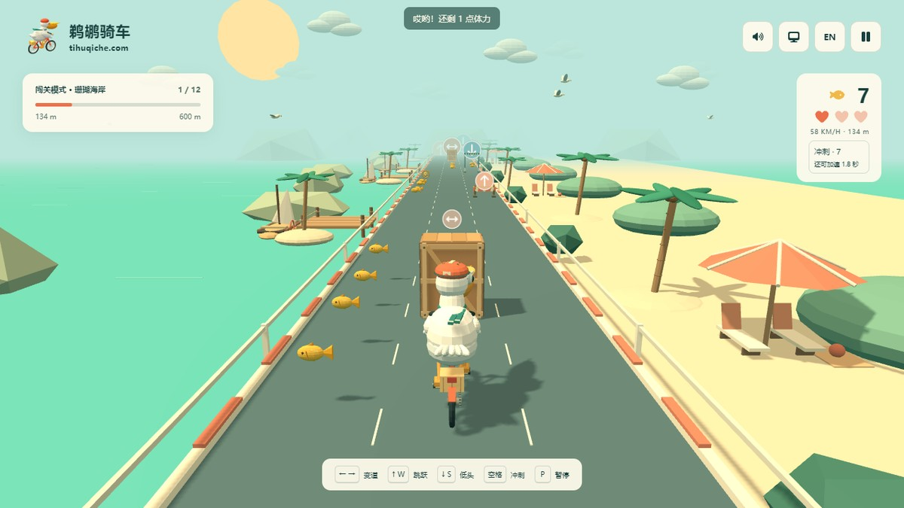
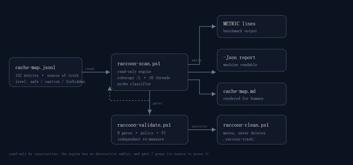

# flying~dragon

**Делаю то, что можно поставить, открыть и проверить: расширения pi, MCP-серверы, инструменты для внутренностей Windows — и 3D-продукты, в которые реально можно играть.**

Два опубликованных npm-пакета, одна 3D-игра на собственном домене и аудит Windows только для чтения, который освободил 30.53 ГБ, не потеряв ни байта.

<a href="https://github.com/flying-dragon-ai">GitHub</a> · <a href="https://pi.dev/packages">пакеты pi</a> · <a href="https://tihuqiche.com/">Играть в tihuqiche</a> · [English](README.md) · [简体中文](README.zh-CN.md) · [日本語](README.ja.md) · [한국어](README.ko.md) · **[Русский](README.ru.md)**

---

## 01 · Избранное

<table>
<tr><td width="50%" valign="top">
<strong><a href="https://github.com/flying-dragon-ai/tihuqiche">Pelican Pedal Run</a></strong>

12 уровней по островам и городам, 4 режима, офлайн-сборка одним файлом. Vue 3 + Three.js, играть можно прямо сейчас в браузере.

<a href="https://tihuqiche.com/">Играть ↗</a>
</td><td width="50%" valign="top">
<strong><a href="https://github.com/flying-dragon-ai/pet-world">Питомец под присмотром</a></strong>

Мобильное приложение для питомцев: вопросы к ИИ, дневник здоровья, прямые эфиры. Развёрнуто и открывается — это не скриншот в презентации.

<a href="https://flying-dragon-ai.github.io/pet-world/">Открыть ↗</a>
</td></tr>
<tr><td width="50%" valign="top">
<strong><a href="https://github.com/flying-dragon-ai/win-raccoon-lab">win-raccoon</a></strong>

Аудит кэша Windows только для чтения: 152 измеренные записи, 9 предохранителей, 30.53 ГБ освобождено без потери данных. В движке нет ни одного разрушительного командлета, и предохранитель 7 грепает собственный исходник, чтобы это доказать.

<a href="https://github.com/flying-dragon-ai/win-raccoon-lab">Исходники ↗</a>
</td><td width="50%" valign="top">
<strong><a href="https://github.com/flying-dragon-ai/figma-mcp-plus">figma-mcp-plus</a></strong>

Из Figma в код через движок правил из 8 ступеней — DSL, дерево, раскладка, визуальная обработка, экспорт — с точностью 98%+ SSIM. VLM здесь резерв, а не метод.

<a href="https://github.com/flying-dragon-ai/figma-mcp-plus">Исходники ↗</a>
</td></tr>
</table>

## 02 · Инструменты

| Инструмент | Что делает | Установка |
| --- | --- | --- |
| **[pi-subagent-factory](https://github.com/flying-dragon-ai/pi-subagent-factory)** | Просматривает до 6 000 файлов и выдаёт 4–10 субагентов с разрешёнными инструментами. Ноль токенов модели на сканирование. | `pi install npm:pi-subagent-factory` |
| **[pi-provider-xhx](https://github.com/flying-dragon-ai/pi-provider-xhx)** | 小浣熊 как полноценный провайдер pi: OAuth через loopback, живой каталог моделей, стриминг через собственный клиент pi. | `pi install npm:pi-provider-xhx` |
| **[seedance-agent](https://github.com/flying-dragon-ai/seedance-agent)** | Предполётная проверка раскадровки, упорядоченная ротация ключей, докачиваемые загрузки, постобработка в ffmpeg. AIGC-видео, которое можно перезапустить, а не перекупить. | — |
| **[msep-blind](https://github.com/flying-dragon-ai/msep-blind)** | Останавливает агент Infogo MSEP на рабочей станции, переживает перезагрузку и полностью откатывается по требованию. PowerShell, без зависимостей. | — |

## 03 · Вклад в апстрим

Только влитые пул-реквесты. Два из них — мои собственные репозитории, остальные — патчи, отправленные в чужие проекты и принятые там.

| Репозиторий | Влитые PR | Последнее изменение |
| --- | --- | --- |
| [flying-dragon-ai/interview-new](https://github.com/flying-dragon-ai/interview-new) | [2](https://github.com/flying-dragon-ai/interview-new/pull/2) · [1](https://github.com/flying-dragon-ai/interview-new/pull/1) | 多角色 StepFun Realtime 全双工（无领导讨论 + 可配置单面） |
| [Frankieli123/grok-skill](https://github.com/Frankieli123/grok-skill) | [2](https://github.com/Frankieli123/grok-skill/pull/2) | feat(api): 优化 JSON 解析与支持 SSE 流解析 |
| [TEN-framework/ten-framework](https://github.com/TEN-framework/ten-framework) | [2028](https://github.com/TEN-framework/ten-framework/pull/2028) | #2014 docs(voice-assistant): 重构README，详细说明PowerMem记忆功能 |
| [labring/FastGPT](https://github.com/labring/FastGPT) | [6338](https://github.com/labring/FastGPT/pull/6338) | #6193 feat(SeekDB): 集成支持 SeekDB 向量数据库 |

## 04 · Над чем работаю

| | |
| --- | --- |
| **Проблема** | figma-mcp-plus всё ещё откатывается к VLM на глубоко перекрывающихся раскладках. |
| **Моя оценка** | DSL фиксирует перекрытие, выход за границы и вложенность, но не фиксирует намерение z-order, поэтому ступень раскладки не может детерминированно разрешить порядок наложения. |
| **Следующая проверка** | Вставить ступень разрешения перекрытий между деревом и раскладкой и измерить SSIM на фиксированном корпусе из 20 экранов с перекрытиями до и после. |

## 05 · Цель и доказательства

| Цель | Ключевой результат | Доказательство | Что это значит |
| --- | --- | --- | --- |
| **O1** Отдавать инструменты, которые ставятся | KR1 · два npm-пакета опубликованы | pi-subagent-factory 0.1.0 · pi-provider-xhx 0.3.0 — оба через `pi install npm:…` | Внедрение стоит одну команду, а не чтение исходников |
| **O2** Сделать системные инструменты проверяемыми | KR2 · 30.53 ГБ освобождено, потерь данных ноль | win-raccoon-lab: 152 измеренные записи кэша, 9 предохранителей, probe F1 = 1.00 | Очистка становится работой с доказательствами, а не ставкой на одну кнопку |
| **O3** Держать ритм | KR3 · вкладов 427 / активных дней 75 | 21 собственных репозиториев на 5 языках, пик 69 за один день | Результат — это ритм, а не вспышка |

<strong>Стек и живой сигнал</strong>

| # | Технология | Где применяется |
| --- | --- | --- |
| 1 | **Python** | MCP-серверы, AIGC-конвейеры, бэкенды на FastAPI |
| 2 | **TypeScript** | расширения pi, фронтенды Vue 3 / React 19, мини-программы |
| 3 | **JavaScript** | однофайловые 3D-игры, npm-навыки, сборочные скрипты |
| 4 | **PowerShell** | аудит Windows только для чтения, инструменты для конечных точек |
| 5 | **Three.js / R3F** | 3D в вебе — tihuqiche, фронтенд агентского кафе |
| 6 | **HTML / CSS** | офлайн-поставки одним файлом |

## 06 · Контакты

Единственная дверь — GitHub. Issue в нужном репозитории быстрее письма.

[GitHub](https://github.com/flying-dragon-ai) · [пакеты pi](https://pi.dev/packages) · [Играть в tihuqiche](https://tihuqiche.com/)

README и все SVG выше собраны из живых данных GitHub через `gh` · since 2019
