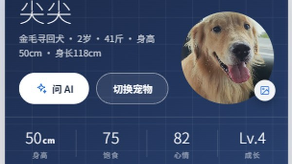

# flying~dragon

**我做能装、能玩、能验的东西：pi 扩展、MCP 服务、Windows 内部工具，以及真的能打开来玩的 3D 产品。**

两个 npm 包、一个跑在自有域名上的 3D 游戏，和一个回收了 30.53 GB 却一个字节都没丢的只读 Windows 审计工具。

<a href="https://github.com/flying-dragon-ai">GitHub</a> · <a href="https://pi.dev/packages">pi 扩展包</a> · <a href="https://tihuqiche.com/">试玩鹈鹕骑车</a> · [English](README.md) · **[简体中文](README.zh-CN.md)** · [日本語](README.ja.md) · [한국어](README.ko.md) · [Русский](README.ru.md)

---

## 01 · 精选

<table>
<tr><td width="50%" valign="top">
<strong><a href="https://github.com/flying-dragon-ai/tihuqiche">鹈鹕骑车</a></strong>

12 关跨海岛与城市，4 种模式，单文件离线包。Vue 3 + Three.js，现在就能在浏览器里玩。

<a href="https://tihuqiche.com/">在线游玩 ↗</a>
</td><td width="50%" valign="top">
<strong><a href="https://github.com/flying-dragon-ai/pet-world">宠物数字管家</a></strong>

移动端宠物管理应用：AI 问答、健康陪伴、直播。已部署可点开，不是 PPT 里的截图。

<a href="https://flying-dragon-ai.github.io/pet-world/">打开 ↗</a>
</td></tr>
<tr><td width="50%" valign="top">
<strong><a href="https://github.com/flying-dragon-ai/win-raccoon-lab">win-raccoon</a></strong>

只读 Windows 缓存审计：152 条实测缓存地图、9 道安全闸门、回收 30.53 GB 零数据丢失。引擎里没有任何破坏性 cmdlet，第 7 道闸门会 grep 自己的源码来证明这一点。

<a href="https://github.com/flying-dragon-ai/win-raccoon-lab">源码 ↗</a>
</td><td width="50%" valign="top">
<strong><a href="https://github.com/flying-dragon-ai/figma-mcp-plus">figma-mcp-plus</a></strong>

Figma 转代码走 8 阶段规则引擎——DSL、树、布局、视觉、导出——还原度 98%+ SSIM。VLM 是兜底，不是方法。

<a href="https://github.com/flying-dragon-ai/figma-mcp-plus">源码 ↗</a>
</td></tr>
</table>

## 02 · 工具链

| 工具 | 做什么 | 安装 |
| --- | --- | --- |
| **[pi-subagent-factory](https://github.com/flying-dragon-ai/pi-subagent-factory)** | 扫描最多 6000 个文件，生成 4–10 个 subagent，每个带工具白名单。扫描零模型 token。 | `pi install npm:pi-subagent-factory` |
| **[pi-provider-xhx](https://github.com/flying-dragon-ai/pi-provider-xhx)** | 把「小浣熊」接成 pi 的一等 provider：OAuth 回环登录、实时模型目录、走 pi 自己的流式客户端。 | `pi install npm:pi-provider-xhx` |
| **[seedance-agent](https://github.com/flying-dragon-ai/seedance-agent)** | 分镜预检、凭据有序轮转、断点续跑、ffmpeg 后期。AIGC 视频可以重跑，而不是重买。 | — |
| **[msep-blind](https://github.com/flying-dragon-ai/msep-blind)** | 让盈高 MSEP 终端安控在这台机器上停止工作，扛过重启，随时可完整恢复。PowerShell，零依赖。 | — |

## 03 · 上游贡献

只列已合并的 PR。其中两个是我自己的仓库，其余是我给上游项目提交并被合入的补丁。

| 仓库 | 已合并 PR | 最近改动 |
| --- | --- | --- |
| [flying-dragon-ai/interview-new](https://github.com/flying-dragon-ai/interview-new) | [2](https://github.com/flying-dragon-ai/interview-new/pull/2) · [1](https://github.com/flying-dragon-ai/interview-new/pull/1) | 多角色 StepFun Realtime 全双工（无领导讨论 + 可配置单面） |
| [Frankieli123/grok-skill](https://github.com/Frankieli123/grok-skill) | [2](https://github.com/Frankieli123/grok-skill/pull/2) | feat(api): 优化 JSON 解析与支持 SSE 流解析 |
| [TEN-framework/ten-framework](https://github.com/TEN-framework/ten-framework) | [2028](https://github.com/TEN-framework/ten-framework/pull/2028) | #2014 docs(voice-assistant): 重构README，详细说明PowerMem记忆功能 |
| [labring/FastGPT](https://github.com/labring/FastGPT) | [6338](https://github.com/labring/FastGPT/pull/6338) | #6193 feat(SeekDB): 集成支持 SeekDB 向量数据库 |

## 04 · 当前在解决

| | |
| --- | --- |
| **问题** | figma-mcp-plus 在深度重叠布局上仍要回落到 VLM。 |
| **我的判断** | DSL 记录了重叠、溢出与包含关系，但没有记录 z-order 意图，布局阶段无法确定性地解出层叠顺序。 |
| **下一步验证** | 在树与布局之间插入一层重叠解析，用固定的 20 屏重叠语料做前后 SSIM 对比。 |

## 05 · 目标与证据

| 目标 | 关键结果 | 证据 | 这意味着什么 |
| --- | --- | --- | --- |
| **O1** 交付别人装得上的 agent 工具 | KR1 · 两个 npm 包已发布 | pi-subagent-factory 0.1.0 · pi-provider-xhx 0.3.0 —— 都是 `pi install npm:…` | 接入成本是一条命令，不是读一遍源码 |
| **O2** 让系统工具可审计 | KR2 · 回收 30.53 GB，零数据丢失 | win-raccoon-lab：152 条实测缓存、9 道安全闸门、probe F1 = 1.00 | 清理从「一键优化赌一把」变成先给证据再给选择 |
| **O3** 保持交付节奏 | KR3 · 462 次贡献 / 78 个活跃日 | 21 个自有仓库覆盖 5 种语言，单日峰值 69 次 | 产出是节奏，不是爆发 |

<strong>技术栈与实时信号</strong>

| # | 技术 | 用于什么场景 |
| --- | --- | --- |
| 1 | **Python** | MCP 服务、AIGC 管线、FastAPI 后端 |
| 2 | **TypeScript** | pi 扩展、Vue 3 / React 19 前端、小程序 |
| 3 | **JavaScript** | 单文件 3D 游戏、npm skill、构建脚本 |
| 4 | **PowerShell** | Windows 只读审计、终端安控工具 |
| 5 | **Three.js / R3F** | 3D Web —— 鹈鹕骑车、智能体餐厅前端 |
| 6 | **HTML / CSS** | 可离线单文件交付物 |

## 06 · 联系

GitHub 是唯一入口。在对应仓库开 issue 比发邮件快。

[GitHub](https://github.com/flying-dragon-ai) · [pi 扩展包](https://pi.dev/packages) · [试玩鹈鹕骑车](https://tihuqiche.com/)

README 与上方全部 SVG 均由 `gh` 拉取真实数据后生成 · since 2019
