<div align="center">


<br>

<sub>[English](README.md) · **[简体中文](README.zh-CN.md)** · [日本語](README.ja.md) · [한국어](README.ko.md) · [Русский](README.ru.md)</sub>

</div>

---

**我做能落地的 agent 基础设施：pi 扩展、MCP 服务、Windows 内部工具。近 12 个月 382 次贡献、73 个活跃日，其中三个项目一条命令就能装上。**

```yaml
role:     工程师 · agent 基础设施与 Windows 内部工具
focus:    pi 扩展 · MCP 服务 · 只读系统工具
proof:    figma-mcp-plus — 8 阶段规则引擎，98%+ SSIM 设计稿转代码
cadence:  382 次贡献 / 73 个活跃日 / 单日峰值 69
contact:  github.com/flying-dragon-ai
```

## 01 · 目标与关键结果

| 目标 | 关键结果 | 进展与证据 | 这意味着什么 |
| --- | --- | --- | --- |
| **O1** 让 agent 能力可交付 | KR1 · 三个包一条命令安装 | pi-provider-xhx、pi-subagent-factory、knowledge-takeback-skill —— `pi install npm:…` / `npx …` | 接入成本是一条命令，不是读一遍源码 |
| **O1** 让 agent 能力可交付 | KR2 · 设计稿转代码还原度 ≥ 98% SSIM | figma-mcp-plus：8 阶段流水线，规则引擎优先，VLM 只做兜底 | 设计交接不再等于手工重画一遍 |
| **O2** 让系统工具可审计 | KR3 · 回收 30.53 GB，零数据丢失 | win-raccoon-lab：152 条实测缓存地图、9 道安全闸门、probe F1 = 1.00 | 清理从「一键优化赌一把」变成先给证据再给选择 |
| **O3** 保持交付节奏 | KR4 · 382 次贡献 / 73 个活跃日 | 18 个自有仓库覆盖 5 种语言，单日峰值 69 次 | 产出是节奏，不是爆发 |

<div align="center"></div>

## 02 · 精选项目

### [figma-mcp-plus](https://github.com/flying-dragon-ai/figma-mcp-plus)

- **问题** — Figma 转代码通常靠视觉模型猜像素：两次运行还原度不一样，每次尝试都在烧 token。
- **我做了什么** — 写了规则化布局引擎——8 阶段流水线（DSL → 树 → 布局 → 视觉 → 导出），VLM 降级为兜底；产物是含 index.html、切图与字体的 ZIP，任何 LLM 都能接着转 React、Vue、Swift 或 Kotlin。
- **结果与影响** — 还原度 98%+ SSIM，同一份设计两次产出同一份代码。

### [win-raccoon-lab](https://github.com/flying-dragon-ai/win-raccoon-lab)

- **问题** — 清理软件让你点「一键优化」，然后你永远不知道它删了什么。
- **我做了什么** — 做了只读审计：152 条缓存路径对着本机实测体积，按三级安全等级分类，动一个字节之前先过 9 道闸门。
- **结果与影响** — 实测回收 30.53 GB，零数据丢失；实测集上 probe F1 = 1.00。

### [pi-subagent-factory](https://github.com/flying-dragon-ai/pi-subagent-factory)

- **问题** — 每个项目都要手写一套 subagent 团队，而名单会悄悄和真实技术栈脱节。
- **我做了什么** — 规则引擎扫描最多 6000 个文件——语言、框架、数据库、测试框架、构建工具、monorepo、Docker、CI——确定性生成 4–10 个 agent，每个带工具白名单与思考等级。
- **结果与影响** — 扫描零模型 token；React + Prisma + Vitest 项目 5 秒内出 8 个 agent。

### [seedance-agent](https://github.com/flying-dragon-ai/seedance-agent) · ★2

- **问题** — AIGC 长视频生成不可复现：一个凭据失效或一次轮询丢失，整条预算就烧掉了。
- **我做了什么** — 分镜预检、凭据有序轮转、异步轮询、断点续跑、ffmpeg 后期，外加一份教会 agent 自己驱动管线的技能文件。
- **结果与影响** — 分镜从最后一个可用片段续跑，而不是从零重来。

## 03 · 当前在解决

| | |
| --- | --- |
| **问题** | figma-mcp-plus 在深度重叠布局上仍要回落到 VLM。 |
| **我的判断** | DSL 记录了重叠、溢出与包含关系，但没有记录 z-order 意图，布局阶段无法确定性地解出层叠顺序。 |
| **下一步验证** | 在树与布局之间插入一层重叠解析，用固定的 20 屏重叠语料做前后 SSIM 对比。 |

## 04 · 技术栈

| # | 技术 | 用于什么场景 |
| --- | --- | --- |
| 1 | **Python** | MCP 服务、AIGC 管线、FastAPI 后端 |
| 2 | **TypeScript** | pi 扩展、Vue 3 / React 19 前端、小程序 |
| 3 | **JavaScript** | 单文件 3D 游戏、npm skill、构建脚本 |
| 4 | **PowerShell** | Windows 只读审计、终端安控工具 |
| 5 | **Three.js / R3F** | 3D Web —— 鹈鹕骑车、智能体餐厅前端 |
| 6 | **HTML / CSS** | 可离线单文件交付物 |

## 05 · 联系

GitHub 是唯一入口。在对应仓库开 issue 比发邮件快。

[GitHub](https://github.com/flying-dragon-ai) · [pi 扩展包](https://pi.dev/packages) · [试玩鹈鹕骑车](https://tihuqiche.com/)

<div align="center"></div>

<sub>README 与上方全部 SVG 均由 `gh` 拉取真实数据后生成 · since 2019</sub>
